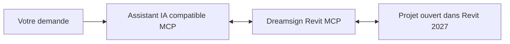

# Dreamsign Revit MCP

[](https://github.com/Dreamsigner/Dreamsign_Revit_MCP/actions/workflows/test.yml)
[](LICENSE)

**Connectez un assistant IA à Revit pour explorer un modèle et automatiser des tâches BIM.**

Dreamsign Revit MCP permet à un assistant compatible MCP de lire un projet Revit, créer des éléments et effectuer des modifications à partir de demandes en langage naturel. Il s’adresse aux architectes, aux équipes BIM et aux développeurs qui souhaitent automatiser des tâches répétitives dans **Revit 2027 sur Windows**.

Le MCP fournit les outils de connexion et d’action ; l’assistant IA interprète la demande et les utilise. Un client IA compatible est donc nécessaire : le plugin ne constitue pas, à lui seul, une interface de conversation.



## À quoi sert-il ?

| Besoin | Fonctions disponibles |
|---|---|
| Comprendre un modèle | Lire les niveaux, rechercher des éléments, inspecter leurs types et propriétés |
| Créer des éléments | Murs, portes et fenêtres hébergées, pièces, étiquettes, quadrillages et composants |
| Automatiser des modifications | Régler les allèges de fenêtres, attribuer des repères, étiqueter des pièces |
| Contrôler une intervention | Prévisualiser des actions, comparer des états et vérifier les éléments modifiés |
| Réduire les échanges avec l’IA | Exécuter des actions par lots et recevoir des résultats compacts |

Exemples de demandes à adresser à l’assistant :

> « Liste les niveaux et compte les fenêtres du RDC, sans modifier le modèle. »
>
> « Prépare le passage des allèges des fenêtres du RDC à 0,80 m. Montre les éléments concernés avant d’appliquer. »
>
> « Étiquette les pièces fermées qui ne sont pas encore étiquetées dans cette vue, avec le type déjà chargé. »

La création de géométrie exige des dimensions, des types et des hôtes identifiés. Une photo ou un croquis ne devient pas automatiquement un modèle fidèle : l’assistant doit en analyser les informations et faire clarifier les données manquantes.

## Compatibilité et prérequis

| Composant | Requis |
|---|---|
| Système | Windows |
| Revit | Revit 2027 installé et licencié ; autres versions non validées |
| Node.js | Version 22 ou supérieure, accessible avec `node` |
| PowerShell | Version 7.6 utilisant .NET 10 ; Windows PowerShell 5.1 ne convient pas |
| Assistant IA | Client acceptant un serveur MCP local sur stdio |
| Git | Pour le téléchargement par commande ; une archive ZIP peut aussi être utilisée |

**Distribution actuelle : installation depuis les sources.** Il faut compiler le plugin sur un poste équipé de Revit. Aucun installateur prêt à l’emploi ni DLL Autodesk n’est fourni. Le serveur Node.js ne nécessite pas d’installation de paquets npm.

## Démarrage rapide

### 1. Télécharger le projet

Ouvrez **PowerShell 7.6**, puis choisissez un dossier stable et accessible en écriture :

```powershell
git clone https://github.com/Dreamsigner/Dreamsign_Revit_MCP.git
Set-Location Dreamsign_Revit_MCP
node --version
$PSVersionTable.PSVersion
```

Sans Git, utilisez **Code → Download ZIP** sur GitHub, extrayez l’archive, puis ouvrez PowerShell 7.6 dans le dossier extrait.

### 2. Compiler et installer le plugin Revit

Dans le dossier téléchargé, exécutez les commandes dans cet ordre. En cas d’erreur, corrigez-la avant de poursuivre.

```powershell
node generate-contract.mjs
node test.mjs
node features.test.mjs
./build.ps1
./install.ps1
Copy-Item project-state.example.json project-state.json
```

Si Revit n’est pas installé à son emplacement standard, remplacez la commande de compilation par :

```powershell
./build.ps1 -RevitDirectory 'D:\Applications\Revit 2027'
```

L’installateur enregistre le plugin dans le dossier utilisateur des compléments Revit 2027. Enregistrez votre travail, puis redémarrez l’instance Revit qui utilisera le MCP. Ne déplacez pas ensuite le dossier du dépôt : le manifeste pointe vers les fichiers compilés qu’il contient.

Dans le gestionnaire de compléments, le plugin porte actuellement le nom technique **Astra Revit Local Bridge**.

### 3. Choisir le projet à piloter

Pour le premier essai, créez manuellement dans Revit un projet vide depuis un gabarit architectural, puis enregistrez-le, par exemple sous `C:\Projects\AstraBridge-Test-Demo.rvt`.

Ouvrez `project-state.json` dans un éditeur de texte et adaptez uniquement les valeurs de `target` à ce fichier :

```json
{
  "pid": null,
  "document": "AstraBridge-Test-Demo",
  "path": "C:\\Projects\\AstraBridge-Test-Demo.rvt"
}
```

Ce bloc représente la valeur de `target`, pas le fichier entier : conservez les autres propriétés. `document` correspond au titre du document Revit, normalement sans `.rvt`. `path` est le chemin absolu du fichier enregistré. Gardez ce document actif dans Revit.

Avec `pid: null`, le MCP recherche l’instance correspondant au titre **et** au chemin. Il refuse les correspondances ambiguës. Les chemins et identifiants stockés dans `project-state.json` sont locaux ; ce fichier est exclu de Git.

### 4. Connecter l’assistant IA

**Codex :** ajoutez l’entrée suivante à `%USERPROFILE%\.codex\config.toml`. Adaptez les chemins aux emplacements réels de Node.js et du dépôt ; `Get-Command node` permet de retrouver le programme Node.js.

```toml
[mcp_servers.dreamsign_revit]
command = 'C:\Program Files\nodejs\node.exe'
args = ['C:\Tools\Dreamsign_Revit_MCP\server.mjs']

[mcp_servers.dreamsign_revit.env]
ASTRA_MCP_PROFILE = 'modeling'
```

**Autre client MCP :** ajoutez un serveur stdio avec ce même programme, les mêmes arguments et la variable `ASTRA_MCP_PROFILE=modeling`. La structure JSON couramment utilisée est :

```json
{
  "mcpServers": {
    "dreamsign_revit": {
      "command": "C:\\Program Files\\nodejs\\node.exe",
      "args": ["C:\\Tools\\Dreamsign_Revit_MCP\\server.mjs"],
      "env": {"ASTRA_MCP_PROFILE": "modeling"}
    }
  }
}
```

Le fichier et le menu de configuration dépendent du client. Rechargez la connexion MCP, ou redémarrez le client, après l’ajout. Ne créez pas une seconde entrée si le même bridge est déjà connecté sous un autre nom.

### 5. Vérifier la connexion et essayer

Dans la conversation de l’assistant, commencez par cette demande en lecture seule :

```text
Utilise dreamsign_revit. Appelle discover_instances puis get_active_document.
Vérifie que le titre et le chemin correspondent au projet de test configuré.
Liste ensuite ses niveaux avec get_levels. Ne modifie aucun élément.
```

Le résultat doit identifier le projet attendu et fournir ses niveaux. `get_active_document` retourne aussi un `document_token`, utilisé par les outils d’écriture pour vérifier l’identité du document.

Lorsque cette lecture réussit, ce premier exercice peut être exécuté **dans le projet de test uniquement** :

```text
Vérifie à nouveau le document actif : il doit être AstraBridge-Test-Demo.
Crée un niveau temporaire à 12,345 m, avec un nom et un source_id uniques.
Relis-le pour vérifier son altitude. Supprime ensuite uniquement ce niveau
à partir de son UniqueId, puis vérifie son absence. N’effectue aucune autre
modification et ne sauvegarde pas le projet.
```

Cet exercice crée puis supprime réellement un élément. Une réussite confirme une première chaîne lecture → écriture → vérification → nettoyage ; elle ne valide pas toutes les fonctions de modélisation.

## Choisir les outils accessibles

Le profil `modeling` utilisé ci-dessus permet les premières opérations de création. Changez `ASTRA_MCP_PROFILE` selon l’usage, puis rechargez la connexion :

| Profil | Usage |
|---|---|
| `inspection` | Lectures et captures d’état, sans outils de modification du modèle |
| `workflow` — défaut si la variable est absente | Lectures, sauvegarde et procédures métier |
| `modeling` | Lectures, création, modification, suppression et procédures métier |
| `diagnostic` | Lectures et création d’un projet de test avec gabarit configuré |
| `full` | Tous les outils, dont lots bruts et prévisualisation générique |

Les outils absents d’un profil sont également refusés à l’appel. Le contrat détaillé des filtres, snapshots et plans est décrit dans [la référence des fonctions](FEATURES-0.3.md).

## Dépannage

| Symptôme | Vérification ou action |
|---|---|
| `node` n’est pas reconnu | Installer Node.js ou corriger son `PATH`, puis rouvrir PowerShell |
| La compilation échoue | Utiliser PowerShell 7.6/.NET 10, vérifier Revit 2027 et son chemin ; voir le [guide développeur](docs/DEVELOPMENT.md) |
| Aucun add-in accessible / `BRIDGE_UNAVAILABLE` | Vérifier que compilation et installation ont réussi, puis redémarrer l’instance Revit concernée |
| `TARGET_UNAVAILABLE` ou mauvais document | Vérifier le titre, le chemin enregistré, le document actif et `project-state.json` |
| `AMBIGUOUS_TARGET` | Identifier les instances ayant ouvert le même projet avant de continuer ; ne pas fermer un travail non enregistré |
| Un outil de création manque | Choisir `modeling` ou `full`, puis recharger le client MCP |
| Plan ou snapshot périmé | Relire le modèle et préparer un nouveau plan ; les captures expirent après cinq minutes et sont invalidées par les changements pertinents |
| Revit occupé / délai dépassé | Terminer les dialogues ou modes d’édition en cours, puis inspecter le modèle avant de réessayer une écriture |

## État du projet et limites

La version du bridge dont ce dépôt est issu a été testée dans **Revit 2027.2**. La distribution portable est compilée et ses tests hors Revit sont exécutés par GitHub Actions. Une validation complète de cette distribution dans Revit reste à effectuer ; un badge vert ne prouve pas la création correcte d’un modèle.

Les opérations utilisent un pipe Windows réservé au compte courant. Les suppressions entraînant des dépendances supplémentaires sont refusées. Les lots sont limités à 250 actions et les résultats à 100 éléments par page. Les champs `_m` utilisent des mètres. Certaines représentations de mobilier sont simplifiées ; le plugin ne garantit ni conformité réglementaire ni qualité architecturale automatique.

Les écritures peuvent modifier le projet ouvert. Commencez sur un fichier de test, vérifiez les résultats avant sauvegarde et, après un timeout, ne répétez pas une écriture sans lire son résultat dans Revit.

## Documentation et contribution

- [Référence des fonctions et profils](FEATURES-0.3.md)
- [Architecture, compilation, tests avancés et désinstallation](docs/DEVELOPMENT.md)
- [Signaler un problème ou proposer une amélioration](https://github.com/Dreamsigner/Dreamsign_Revit_MCP/issues)

Pour signaler un problème, indiquez la version de Revit, le profil MCP, l’opération et le message d’erreur. Retirez les chemins personnels, données de projet et jetons des extraits partagés.

## Licence

Copyright © 2026 Dreamsigner. Distribué sous [licence MIT](LICENSE).
