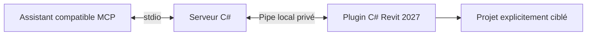

# Dreamsign Revit MCP

[](https://github.com/Dreamsigner/Dreamsign_Revit_MCP/actions/workflows/test.yml)
[](LICENSE)

**Connectez un assistant IA à Revit pour explorer un modèle et automatiser des tâches BIM.**

Dreamsign Revit MCP fournit 24 outils pour **Revit 2027 sur Windows** : consulter un projet, créer des éléments, préparer des modifications et vérifier leurs résultats. Il s’adresse aux architectes, équipes BIM et développeurs utilisant un assistant compatible MCP.

La version **0.4.0** utilise C#/.NET 10 et le SDK MCP officiel. Le serveur, le plugin, l’installation et les tests n’exigent ni Node.js ni scripts PowerShell. JSON reste un format de données.

> Validation : compilation contre Revit 2027, 40 tests hors Revit et essais natifs de la version 0.4 dans un projet dédié sous Revit 2027.2. Les essais portent sur la connexion MCP, les niveaux, la prévisualisation, les captures et le nettoyage ; ils ne constituent pas une validation exhaustive de tous les objets BIM.



## Fonctions

| Besoin | Fonctions |
|---|---|
| Explorer | Niveaux, éléments, types, familles, propriétés et validation d’identifiants |
| Créer | Murs, portes, fenêtres, pièces, étiquettes, quadrillages et composants ; types et hôtes requis |
| Automatiser | Allèges, repères de portes/fenêtres, étiquettes de pièces et suppression de catégories d’étiquettes |
| Préparer | Prévisualisation annulée, puis application d’un plan lié au document et à sa révision |
| Comparer | Captures limitées et comparaison des pages capturées |
| Limiter le contexte IA | Profils d’outils, lots, résultats compacts et rapports complets sur disque |

Exemples de demandes à l’assistant :

> « Liste les niveaux et compte les fenêtres du RDC sans modifier le modèle. »
>
> « Prépare le passage des allèges de ces fenêtres à 0,80 m, puis applique le plan si les contrôles réussissent. »
>
> « Étiquette les pièces fermées de cette vue avec le type déjà chargé. »

Le MCP fournit les actions ; le client IA interprète la demande. Il ne constitue pas une interface de conversation autonome. Une photo ou un croquis exige une analyse préalable : dimensions, types et hôtes doivent être identifiés avant création.

## Prérequis

| Usage | Requis |
|---|---|
| Distribution autonome | Windows x64, Revit 2027 licencié, client MCP local sur stdio |
| Compilation des sources | Les mêmes prérequis, plus SDK .NET **10.0.402 ou supérieur compatible avec global.json** |
| Autres versions de Revit | Non prises en charge |

Aucune DLL Autodesk n’est fournie. Le plugin utilise Revit installé sur le poste. Les instructions ci-dessous construisent la distribution depuis les sources ; elles ne supposent pas qu’une release GitHub existe déjà.

## Installation depuis les sources

### 1. Télécharger et compiler

Téléchargez **Code → Download ZIP**, ou clonez ce dépôt. Dans un terminal ouvert dans le dossier extrait :

```text
dotnet test tests/Dreamsign.Tests/Dreamsign.Tests.csproj -c Release
dotnet build src/Dreamsign.Revit/Dreamsign.Revit.csproj -c Release
dotnet publish src/Dreamsign.Server/Dreamsign.Server.csproj -c Release -r win-x64 --self-contained true -p:PublishSingleFile=true -p:IncludeRevitAddin=true -o artifacts/win-x64
```

Pour un autre emplacement de Revit, ajoutez `-p:RevitDirectory="D:\Applications\Revit 2027"` à la compilation du plugin. `artifacts/win-x64` contient l’exécutable, les notices et le sous-dossier `addin`. Conservez l’ensemble dans un dossier stable.

### 2. Enregistrer le plugin

Depuis le dossier de distribution :

```text
Dreamsign.Revit.Mcp.exe install
```

Le programme copie ses deux DLL dans `%LOCALAPPDATA%\DreamsignRevitMCP\addin`, dans un dossier versionné, puis crée `%APPDATA%\Autodesk\Revit\Addins\2027\AstraRevitBridge.addin`. Il ne ferme ni ne redémarre Revit.

Une installation existante provoque un refus par défaut. Pour remplacer explicitement un ancien bridge reconnu, avec sauvegarde du manifeste :

```text
Dreamsign.Revit.Mcp.exe install --replace-existing
```

Enregistrez votre travail puis relancez l’instance qui utilisera le plugin. Les autres instances ouvertes conservent leur code chargé jusqu’à leur propre redémarrage. Ce manifeste utilisateur s’applique aux futurs lancements de Revit 2027 de ce compte.

### 3. Cibler un projet

Pour le premier essai, créez un projet architectural et enregistrez-le sous `AstraBridge-Test-Demo.rvt`. Gardez-le actif, puis configurez son titre et son chemin absolu :

```text
Dreamsign.Revit.Mcp.exe configure --document AstraBridge-Test-Demo --path "C:\Projects\AstraBridge-Test-Demo.rvt"
Dreamsign.Revit.Mcp.exe doctor
```

Le ciblage compare **titre et chemin complet**. Plusieurs correspondances ou un autre document actif provoquent un refus. `--pid` est facultatif ; un ancien PID ne prouve jamais l’identité du document.

État, correspondances d’éléments et rapports sont locaux dans `%LOCALAPPDATA%\DreamsignRevitMCP`. Pour séparer plusieurs projets, utilisez un `--data-dir` distinct dans **toutes** les commandes et dans le client. Un appel concurrent utilisant ce même dossier est refusé avant envoi à Revit.

### 4. Connecter le client IA

Exemple stdio générique à adapter au client :

```json
{
  "mcpServers": {
    "dreamsign_revit": {
      "command": "C:\\Tools\\DreamsignRevitMCP\\Dreamsign.Revit.Mcp.exe",
      "args": ["serve", "--profile", "modeling", "--data-dir", "C:\\Projects\\Demo-MCP"]
    }
  }
}
```

Avec cet exemple, configurez d’abord la cible avec le même `--data-dir C:\Projects\Demo-MCP`. Entrée équivalente pour Codex :

```toml
[mcp_servers.dreamsign_revit]
command = 'C:\Tools\DreamsignRevitMCP\Dreamsign.Revit.Mcp.exe'
args = ['serve', '--profile', 'modeling', '--data-dir', 'C:\Projects\Demo-MCP']
```

Rechargez la connexion du client. Remplacez l’ancienne entrée Node.js du même bridge pour éviter un doublon. Commencez par demander la lecture du document actif et des niveaux.

## Profils et opérations

| Profil | Outils | Usage |
|---|---:|---|
| `inspection` | 12 | Lecture seule |
| `workflow` | 18 | Défaut : lecture, procédures préparées et sauvegarde |
| `modeling` | 20 | Création, modification et suppression |
| `diagnostic` | 13 | Lecture et création explicite d’un projet de test depuis l’accueil |
| `full` | 24 | Catalogue complet pour développement |

`--profile` prend la priorité sur `ASTRA_MCP_PROFILE`. Consultez les définitions sans Revit avec `Dreamsign.Revit.Mcp.exe catalog --profile full`.

- Les écritures exigent le `document_token` de `get_active_document`, y compris `run_workflow`.
- `set_window_sills`, `assign_marks` et `tag_rooms` préparent un plan ; `apply_plan` l’exécute. Il expire après cinq minutes et devient invalide après changement du document, de sa révision ou de sa vue.
- Les lots sont limités à 250 actions. Un plan consommé ne peut pas être rejoué.
- Après délai dépassé ou réponse incomplète, relisez l’état réel avant une nouvelle écriture. Aucune action n’est relancée automatiquement.
- Un diff de pages capturées ne prouve pas une création ou suppression dans l’ensemble du modèle.
- Le serveur utilise stdio et un pipe Windows accessible à l’utilisateur courant, sans port HTTP public.

Dimensions en mètres, surfaces en m². Les résultats compacts indiquent le rapport complet local. Les tailles JSON ne mesurent pas les tokens facturés ni le coût de l’IA.

## Désinstallation et retour arrière

```text
Dreamsign.Revit.Mcp.exe uninstall
```

Le programme sauvegarde puis retire uniquement son manifeste reconnu. Projets, rapports et DLL versionnées sont conservés. Il refuse le manifeste d’un autre complément ou de l’ancien bridge 0.3. Pour revenir à l’installation précédente, restaurez le manifeste `.addin` sauvegardé dans `backups`, puis relancez l’instance concernée. Ne chargez pas deux manifestes du même bridge.

## Développement et licence

Quatre projets : **Contracts**, **Server**, **Revit**, **Tests**. Le catalogue embarqué est partagé entre serveur et plugin, sans génération JavaScript.

- [Architecture, compilation et tests](docs/DEVELOPMENT.md)
- [Décision et validation de migration](docs/CSHARP-MIGRATION.md)
- [Notices des dépendances](THIRD-PARTY-NOTICES.md)

Un test réel est fourni, désactivé par défaut et limité à `AstraBridge-Test-*`. Les tests hors Revit ne prouvent pas l’exécution de transactions dans l’application. Modèles privés, logs et résultats locaux sont exclus de Git.

Copyright © 2026 Dreamsigner. Code sous [licence MIT](LICENSE) ; dépendances sous leurs licences respectives. Projet indépendant sans affiliation à Autodesk.
