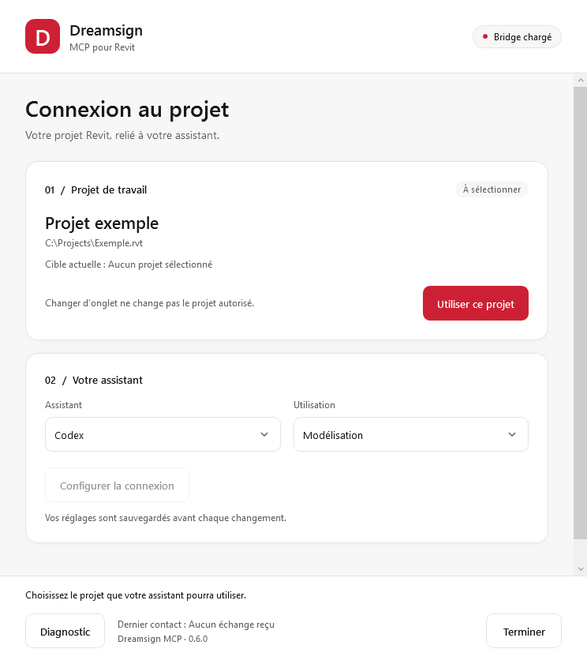

# Dreamsign Revit MCP

Serveur MCP local pour explorer et modifier un projet **Revit 2027 sur Windows**
avec Codex, Claude Desktop, Cursor ou un autre assistant compatible MCP.

Le complément Revit permet de choisir explicitement le projet autorisé et de
configurer l’assistant. Le serveur fournit les outils ; l’assistant interprète
les demandes. La connexion reste locale.

## Installation

Les installateurs publiés sont disponibles dans les **[Releases](https://github.com/Dreamsigner/Dreamsign_Revit_MCP/releases)**.
La documentation de cette branche décrit la version **0.6** ; consulter les notes
de la release téléchargée pour connaître son périmètre et son empreinte SHA-256.
Aucune compilation n’est demandée aux utilisateurs.

Pour 0.6 :

1. Lancer `Dreamsign_MCP_Setup_0.6.0.exe` avec l’autorisation administrateur.
2. Ouvrir Revit 2027 dans la session habituelle, sans droits administrateur.
3. Ouvrir un projet enregistré, puis **Compléments → Dreamsign MCP**.
4. Cliquer sur **Utiliser ce projet**, choisir l’assistant et configurer la connexion.
5. Fermer le panneau avec **Terminer**, puis recharger la connexion MCP dans l’assistant.

Le complément est chargé au lancement de Revit. Les binaires ne sont pas signés :
une confirmation Windows ou Revit peut être nécessaire. Chaque utilisateur
conserve ses propres paramètres. Pour migrer depuis 0.5 ou désinstaller,
voir le [guide d’installation](docs/MACHINE-INSTALLATION.md).

## Fonctions

| Usage | Outils |
|---|---|
| Inspection | Niveaux, recherche d’éléments, familles, types et propriétés |
| Modélisation | Murs, portes, fenêtres, pièces, étiquettes, quadrillages et composants |
| Automatisation | Allèges, repères, étiquetage et lots préparés |
| Vérification | Prévisualisation, plans à usage unique et comparaison de captures |

Exemples : « Liste les niveaux sans modifier le modèle » ou « Prépare le passage
des allèges de ces fenêtres à 0,80 m ». Commencer par le mode **Lecture seule**.
Les dimensions sont en mètres et les surfaces en m².

## Limites

La cible est vérifiée par titre et chemin complet ; changer d’onglet ne change
pas son autorisation. Après un délai dépassé, relire l’état du modèle avant toute
nouvelle écriture : les opérations ne sont pas relancées automatiquement.
Le panneau modal doit être fermé avant les appels MCP.

Les autres versions de Revit et les modèles cloud ne sont pas validés.
Le [rapport 0.6](docs/VALIDATION-0.6.md) distingue tests automatisés, essais réels
et limites connues. Une reconstruction depuis une image nécessite une analyse
préalable des dimensions, types et hôtes.

## Développement

C#/.NET 10, WPF et installateur WiX/Burn. Lire [CONTRIBUTING.md](CONTRIBUTING.md)
pour les commandes, [ARCHITECTURE.md](ARCHITECTURE.md) pour les composants et
l’[index documentaire](docs/README.md) pour les guides spécialisés.
Voir [SECURITY.md](SECURITY.md) pour le modèle de sécurité et les signalements.

Code sous [licence MIT](LICENSE) ; [notices des dépendances](THIRD-PARTY-NOTICES.md).
Projet indépendant, sans affiliation à Autodesk.
