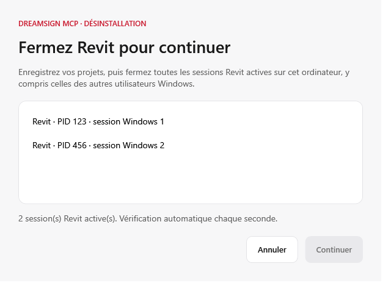

# Installation commune et migration depuis 0.5

La version 0.6 est préparée pour revue, pas encore publiée ni validée en
installation réelle pour tous les comptes. Conserver l’installateur 0.5 et les
sauvegardes jusqu’à validation sur un poste de test.

## Droits et séparation des données

| Emplacement | Usage | Droits requis |
|---|---|---|
| `%ProgramFiles%\DreamsignRevitMCP\0.6.0` | Serveur, complément et licences partagés | Administrateur pour installer, réparer ou désinstaller |
| `%ProgramFiles%\Autodesk\Revit\Addins\2027\AstraRevitBridge.addin` | Enregistrement commun du complément | Administrateur pour modifier |
| `HKLM\Software\Dreamsigner\RevitMCP` — vue 64 bits | Chemin du serveur commun et version | Lecture en usage normal, écriture par l’installation |
| `%LOCALAPPDATA%\DreamsignRevitMCP` | Cible, correspondances, rapports, sauvegardes et journaux de cet utilisateur | Utilisateur courant |
| Configuration de l’assistant | Connexion MCP individuelle | Utilisateur courant |

Il n’existe aucun service Windows ni compte supplémentaire. Revit et le serveur
s’exécutent avec l’identité de l’utilisateur. Le pipe garde `CurrentUserOnly`.
Les journaux du bridge vont dans `logs/bridge-PID.log` du dossier personnel,
jamais à côté des DLL sous Program Files. Les paramètres avancés peuvent
changer le dossier personnel ; ne pas choisir un dossier partagé entre comptes.

Le MSI ne lit pas les reçus des utilisateurs et n’exécute pas le serveur en
tant qu’administrateur. Il possède les fichiers communs, le registre et le
manifeste. L’action WiX XmlFile écrit le chemin absolu de la DLL dans le
manifeste, avec support du rollback. Un manifeste commun préexistant bloque
une première installation pour éviter son remplacement sans vérification.

## Chemin conseillé depuis 0.5

Revit 2027 exige les manifestes communs sous `%ProgramFiles%\Autodesk\Revit\Addins\2027`
et ignore l’ancien emplacement sous `ProgramData`. Le MSI et la migration
utilisent ce même emplacement. Source : [changements officiels du SDK Revit 2027](https://blog.autodesk.io/revit-2027-sdk-net-10-api-changes-and-additions/#add-in-installation-folder-changes).

### Fermer Revit avant de désinstaller

La désinstallation **0.6** vérifie les processus `Revit.exe` de l’ordinateur
avant les contrôles de fichiers en cours d’utilisation et avant toute
modification de l’installation. Si Revit est ouvert, une fenêtre demande
d’enregistrer les projets et de fermer toutes les sessions, y compris celles
des autres comptes Windows. La liste affiche les PID, les sessions Windows et
les titres accessibles ; elle est actualisée chaque seconde. Une session dont
le titre est inaccessible reste bloquante.

**Continuer** reste désactivé jusqu’à la fermeture de toutes les sessions et
vérifie à nouveau les processus au clic. **Annuler** ou fermer cette fenêtre
annule la désinstallation. Le programme ne ferme ni ne termine aucun processus.
Éviter de relancer Revit avant la fin de la désinstallation.

En mode silencieux, passif ou non interactif, la présence de Revit provoque
un échec immédiat, avec le motif dans le journal MSI ; aucune fenêtre n’attend
une intervention. Une erreur de détection bloque aussi l’opération.

Ce contrôle existe dans le MSI et s’applique également à sa désinstallation
directe. Il n’ajoute pas rétroactivement ce comportement à la version **0.5** :
pour retirer cette dernière, enregistrer les projets et fermer Revit soi-même.



### Passage à 0.6

1. Depuis la session ayant installé 0.5, conserver son EXE et ses sauvegardes.
2. Désinstaller 0.5 avec son EXE ou les applications installées de Windows. Sa désinstallation conserve les modèles, l’état et les rapports ; les modifications des configurations sont sauvegardées.
3. Installer 0.6 pour l’ordinateur avec l’autorisation administrateur.
4. Au prochain lancement volontaire de Revit, ouvrir **Compléments → Dreamsign MCP**, choisir le projet et configurer l’assistant. Cela met à jour son chemin de serveur avec sauvegarde.

Les autres comptes ayant leur propre version 0.5 doivent aussi retirer cette
installation depuis leur session. L’administrateur n’efface pas leurs fichiers.
Un changement de compte ne reprend jamais le projet autorisé d’un autre compte.

## Alternative pour un ancien manifeste conservé

Pour un déploiement géré, après installation commune, un utilisateur peut
retirer uniquement son ancien manifeste C# reconnu avec la commande suivante,
dans un terminal normal **sans exécution en tant qu’administrateur** :

```text
"C:\Program Files\DreamsignRevitMCP\0.6.0\Dreamsign.Revit.Mcp.exe" migrate-user
```

Cette commande exige que le serveur et le manifeste communs soient complets et
cohérents. Elle refuse un manifeste étranger, sauvegarde le manifeste reconnu
sous `backups/Dreamsign_MCP_*.addin` puis retire son seul fichier utilisateur.
Elle est répétable, ne change aucun projet ni configuration cliente et ne ferme
pas Revit. Elle ne désinstalle pas l’ancien paquet MSI : sa gestion reste
distincte dans les applications installées. Le dossier de données d’origine
peut être fourni avec `--data-dir` s’il avait été personnalisé.

La commande renvoie le chemin de sauvegarde. Pour revenir à 0.5, désinstaller
la version commune puis réinstaller 0.5 avec son EXE ; restaurer une sauvegarde
de configuration seulement après vérification de son serveur et de son projet.
Ne pas rétablir aveuglément un manifeste pointant vers une DLL supprimée.

Référence : les manifestes utilisateur du même nom prennent priorité sur les
manifestes communs selon la [documentation Autodesk](https://help.autodesk.com/cloudhelp/2026/ENU/Revit-API/files/Revit_API_Developers_Guide/Introduction/Add_In_Integration/Revit_API_Revit_API_Developers_Guide_Introduction_Add_In_Integration_Add_in_Registration_html.html).
Portée du paquet : [WiX PackageScopeType](https://docs.firegiant.com/wix/schema/wxs/packagescopetype/).
